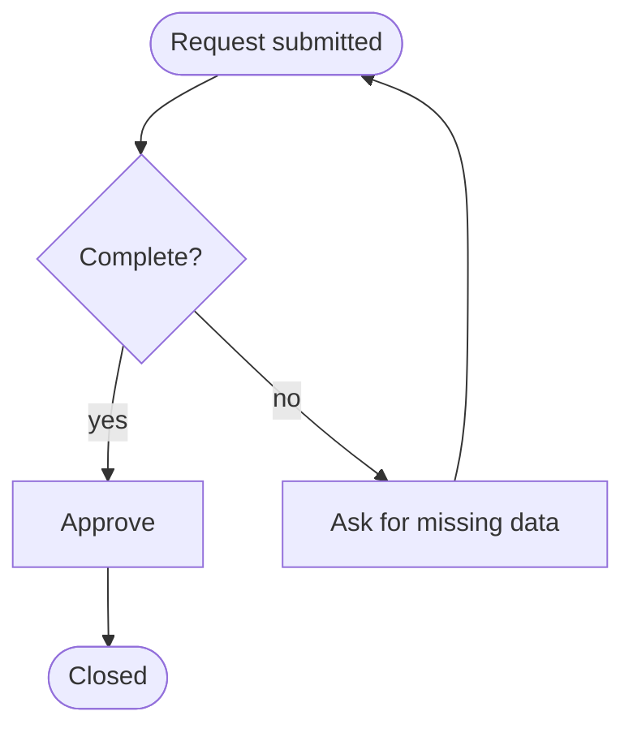
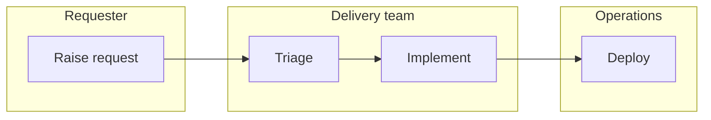
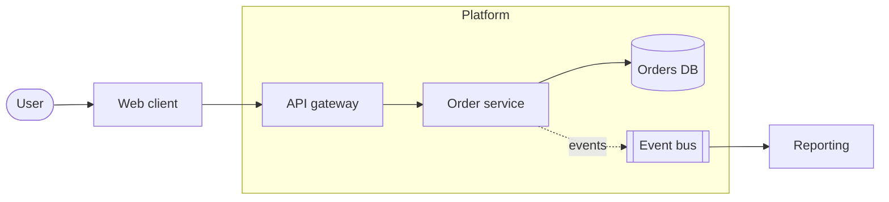
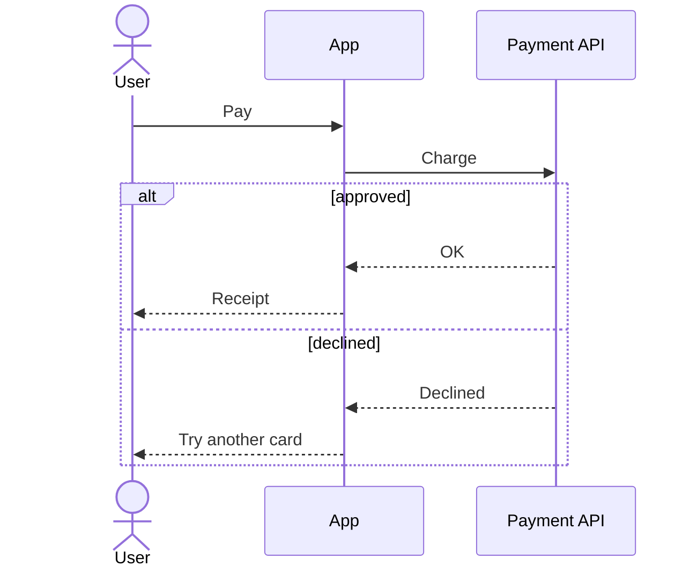
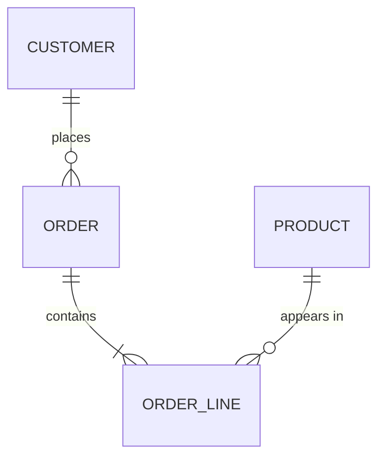
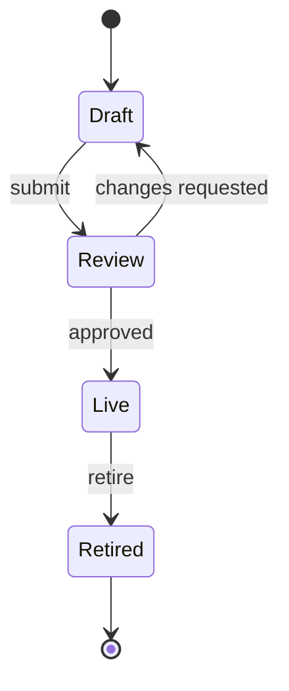
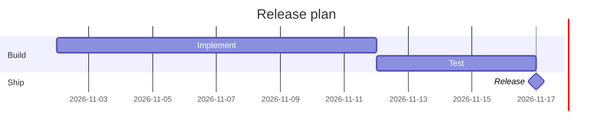
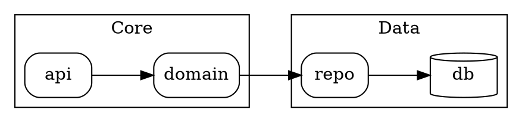
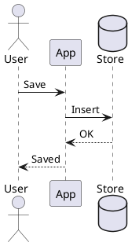

# Diagram patterns

Small starting points. Replace the example names with the user's terms.

## Contents

- Flowchart with a decision and a retry
- Swimlanes
- Service architecture
- Sequence with an error branch
- ER diagram
- State machine
- Gantt
- Graphviz dependency graph with clusters
- PlantUML sequence
- SVG fallback

## Flowchart with a decision and a retry



## Swimlanes



## Service architecture



## Sequence with an error branch



## ER diagram



## State machine



## Gantt



## Graphviz dependency graph with clusters



## PlantUML sequence



## SVG fallback

```svg
<svg xmlns="http://www.w3.org/2000/svg" width="420" height="120" viewBox="0 0 420 120" role="img">
  <title>Two-step flow</title>
  <rect x="10" y="35" width="150" height="50" rx="8" fill="#ffffff" stroke="#333333"/>
  <text x="85" y="65" text-anchor="middle" font-family="sans-serif" font-size="14">Input</text>
  <line x1="160" y1="60" x2="250" y2="60" stroke="#333333" stroke-width="2"/>
  <polygon points="250,54 262,60 250,66" fill="#333333"/>
  <rect x="262" y="35" width="150" height="50" rx="8" fill="#ffffff" stroke="#333333"/>
  <text x="337" y="65" text-anchor="middle" font-family="sans-serif" font-size="14">Output</text>
</svg>
```
