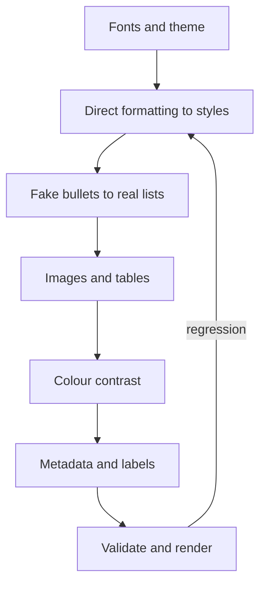

# Repair: DOCX, in dependency order

`scripts/ooxml_fix.py` does the deterministic parts: `--rename-font OLD NEW --bold`, `--strip-embedded-fonts`,
`--bullets` (typed bullets become real list formatting backed by `numbering.xml`) and `--props author=NAME,date=today`.
Styles, headings, tables, images, colour and comments below stay guided. Work only on the copy in the working folder (after the zip-slip check). Same rules as PPTX: parse with
`defusedxml.minidom` or regex on the raw string, never round-trip through `xml.etree.ElementTree`
(it rewrites namespace prefixes), re-validate and re-render after each group, repack with Python in the
input's member order (`snippets.md`, "Repack").

1. **Fonts.** One family for body and one for headings, declared in `word/styles.xml` (`w:docDefaults`
   and the heading styles) and in `word/theme/theme1.xml` (`a:majorFont`, `a:minorFont`), not repeated in
   every run. A fabricated family (a name like "Times New Roman Bold" with its own panose, or an embedded
   `.odttf` for a font that ships with Office) is renamed to the real family, with `w:b` kept, and the
   bogus `w:embedRegular`/`w:embedBold` entries, their relationships and the `.odttf` parts removed.
   Aptos or Calibri in a file claiming to predate the font is reported, not changed.
2. **Direct formatting to styles.** Count distinct `w:rPr`/`w:pPr` combinations. For each combination used
   five or more times on whole paragraphs, create a style in `styles.xml` (or reuse `Heading 1-3`, `Title`,
   `List Paragraph`, `Quote`) and replace the direct formatting with `w:pStyle`. Keep formatting that is
   genuinely local (one bold word). Do not change what the text looks like: render before and after and
   compare. Leave documents with a user template (`w:attachedTemplate`) alone and report instead.
3. **Fake bullets and numbers.** Paragraphs starting with U+2022, `-`, `*`, `1.` typed by hand become real
   lists: add or reuse an abstract number in `word/numbering.xml`, set `w:numPr` on the paragraph, strip the
   typed marker and its trailing tab or space. Keep indentation levels. Count every change.
4. **Headings.** Bold, enlarged lines acting as headings become `Heading 1-3` styles only when the pattern
   is consistent (same size and weight, short, followed by body text). Report the rest.
5. **Images and tables.** Images need alt text (`wp:docPr descr`), no `a:blip` inside shapes no previewer
   draws, inline or anchored with a resolving relationship to `word/media/`. Tables get a header row
   (`w:tblHeader`), no merged cells used for layout where a plain table works (report), widths that fit the
   page. Empty paragraphs used as spacing become paragraph spacing.
6. **Colour.** Text colours that fail 4.5:1 against the page or the shading behind them are darkened along
   the hue (`snippets.md`, "Contrast repair"). Leave colours in logos and in images alone.
7. **Metadata and labels.** As in `repair-pptx.md`, "Metadata and labels": confirmed author in `dc:creator` and
   `cp:lastModifiedBy`, placeholder dates set to today, `Pages`, `Words`, `Characters` fixed from the
   render, stray `dc:identifier` dropped. Sensitivity labels are reported, not removed. `w:rsid` values are
   never invented; a file with none is reported (`docx-html-md.md`).
8. **Comments and tracked changes.** Report them. Never accept, reject or delete them unless asked; if the
   user asks to remove comments, remove `word/comments*.xml`, its relationship, its content type and every
   `w:commentRangeStart/End/Reference`, all together.
9. **Repack with Python**, keeping `[Content_Types].xml` first; a part removed on purpose is left out of the
   member list and its relationship and content type are removed in the same step.

Verify with `verification.md`: render with LibreOffice, `pdffonts` for font resolution, pairwise text
overlap and page-count change (a repair that adds pages is a regression to explain), and diff every text
run against the input so only intended strings changed.
