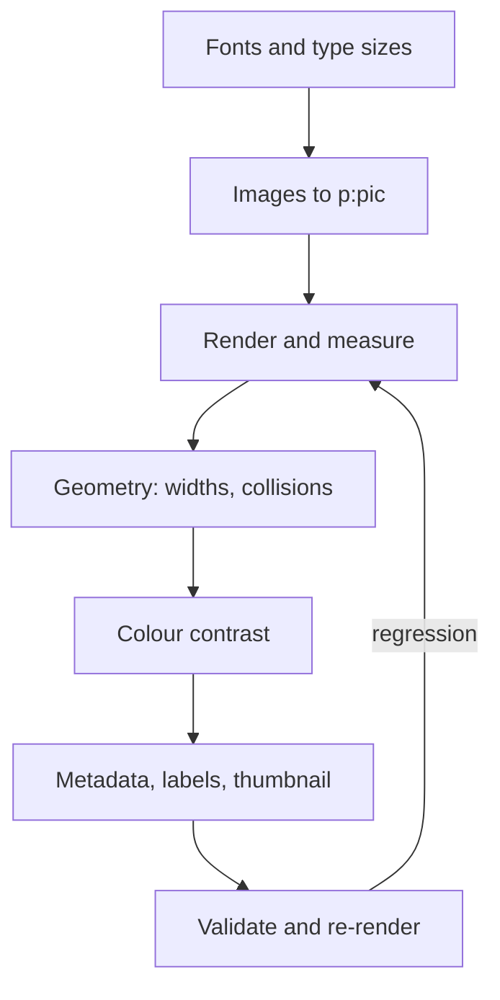

# Repair: PPTX, in dependency order

Deterministic fixes for steps 1 (`--normalize-fonts`, `--rename-font`), 2, 3 (`--images`: rectangle freeforms only), 5 (`--contrast`: literal colours on known backgrounds), 6 and 8 and the embedded-font removal are in `scripts/ooxml_fix.py`
(dry run without `--out`, counts for every fix, never overwrites); use it, then re-render. Steps that need
judgement (images, geometry, colour) stay guided. Order matters. Fixing the font changes text metrics, which changes what collides, which changes what
needs widening. Work only on the copy in the working folder.



1. **Fonts.** A family that does not ship with Office or macOS is replaced by a viewer's fallback, so text reflows.
   `ooxml_inspect.py` lists them; metric-compatible look-alikes (Arimo, Tinos, Cousine, Carlito, Caladea) swap to
   Arial, Times New Roman, Courier New, Calibri, Cambria without reflow; anything else (a Google font such as Fredoka)
   has no safe automatic answer: tell the user, who either picks an installed font or accepts the fallback. Make the
   declaration consistent: one family in `a:latin` (and `a:ea`/`a:cs` where
   present) on runs, in the theme `majorFont`/`minorFont`, and in master/layout text styles, and a
   family that ships with Office and macOS or has an obvious substitute (Arial, Calibri, Georgia,
   Times New Roman, Helvetica Neue), never a made-up bold or "Variable" family. Before renaming a fabricated family, confirm every run using it already carries
   `b="1"` or `b="true"`; if so the rename preserves bold, if not add it. Then drop the bogus
   `<p:embeddedFontLst>`, its relationships, the `.fntdata` parts and the `fntdata` content-type
   default. No embedding is usually right for a font that ships with Office.
2. **Type sizes.** Round only rounding noise - values within 2 of a multiple of 100. Leave deliberate
   half-points (`sz="3150"` = 31.5pt) unless they contradict a sibling. Scale each paragraph's
   `<a:spcPts>` by the same ratio.
3. **Images.** Replace each group/`custGeom`/`blipFill` construct with a real picture, taking position
   and size from the group's `xfrm`, not the child shape's:

   ```xml
   <p:pic><p:nvPicPr><p:cNvPr id="{id}" name="Picture {id}"/>
   <p:cNvPicPr><a:picLocks noChangeAspect="1"/></p:cNvPicPr><p:nvPr/></p:nvPicPr>
   <p:blipFill><a:blip r:embed="{rid}"/><a:stretch><a:fillRect/></a:stretch></p:blipFill>
   <p:spPr><a:xfrm><a:off x="{x}" y="{y}"/><a:ext cx="{cx}" cy="{cy}"/></a:xfrm>
   <a:prstGeom prst="rect"><a:avLst/></a:prstGeom></p:spPr></p:pic>
   ```

   Convert only groups with one shape, no rotation and no flip. Report the rest. `ooxml_fix.py --images` does this for
   rectangle freeforms (and ungrouped ones, rotation kept) and counts the ones it leaves.
4. **Geometry.** `ooxml_fix.py --fit` does the common case: design tools export boxes exactly as wide as their text
   ("Apple" at 58 pt bold in a 2.238 in box), so any renderer that measures a hair wider wraps the word or breaks it inside
   ("Appl/e") and the second line lands on the text below. `ooxml_text.py` estimates widths from Arial metrics; the fix widens
   the box about 12% into free space (centred text grows both ways, right-aligned text grows left), sets wrapping off for a
   single-line title that has no room, and lets a short box grow downwards. Confirm in a render (`slide_preview.py`).
   By hand: Widen boxes only into free space: for each text box, find every shape to its right
   that vertically overlaps it, and stop short of the nearest. About 10% slack absorbs font
   substitution. Skip centred and right-aligned boxes.
5. **Colour.** Convert each failing colour to HLS and binary-search the lightness down until it
   clears 4.5:1 against the background, keeping hue and saturation.
6. **Glyph cleanup** (if the user agreed, default yes). Literal bullet characters become real
   `<a:buChar>` list formatting; prose arrows become words; zero-width characters are removed outside
   RTL text. Count every change.
7. **Speaker notes.** Rewrite generator-facing notes into what a presenter would say aloud for that
   slide: first person, short spoken sentences, a natural transition to the next slide, no source
   lines, no instructions to the model, no bullet dump of the slide. Use only facts on the slide or
   elsewhere in the deck; add no number, name or claim that is not there, and drop "do not claim"
   caveats by keeping the claim itself hedged as the source did. Roughly 40-120 words per content
   slide; leave title/section slides to one or two sentences. Ledger: count notes words
   input/rewritten/added separately. Then audit the new notes with the same register-word and
   residue scan, and tell the user the rewrite is model-written, so the author line still needs
   their own read-through.
8. **Metadata and labels.** Write confirmed values into `core.xml` and `app.xml`; leave author empty if
   unconfirmed; set a placeholder or impossible `dcterms:created`/`modified` to today (W3CDTF, UTC),
   never to the past; fix `Slides`, `Words`, `Notes`, `PresentationFormat` from the real file, and
   drop the stray `dc:identifier`. **Sensitivity labels are reported, not removed.** Only
   if the user explicitly asks to remove the label from this file: it lives in three places -
   `docMetadata/LabelInfo.xml`, its `<Override>` in `[Content_Types].xml`, and its relationship in
   `_rels/.rels` - remove all three, never one or two, and note in the report that the file no longer
   carries the label.
9. **Repack with Python**, not `zip` (`scripts/ooxml_pack.py repack`, see `snippets.md`). Write a new archive from the
   input's member list, in the input's order, reading each member from `unpacked/`, to a temp file in
   `out/`, then rename it into place. This needs no file deletion (which hooks may block), keeps
   `[Content_Types].xml` first, and adds no directory entries - `zip -r` adds them, and the package then
   differs from the original. If you removed a part (a confirmed label removal), leave it out of the
   member list; if you added one, append it.

## XML editing rules

Parse with `defusedxml.minidom`, or use regex on the raw string. Round-tripping OOXML through
`xml.etree.ElementTree` rewrites namespace prefixes and corrupts the package. When splitting a
paragraph, close `</a:t></a:r></a:p>` before opening `<a:p><a:r>`; a missing `</a:r>` is the easiest
way to produce an unopenable file, and validation catches it at once.
